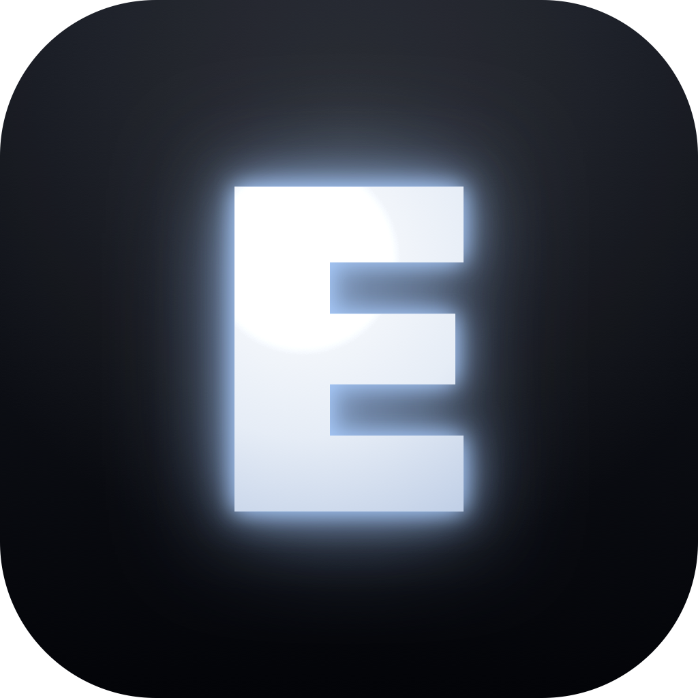

<p align="center">
  
</p>

<h1 align="center">Engram</h1>

<p align="center">
  <b>One shared memory for all your AIs.</b><br>
  Your assistants forget you the moment a chat ends — and each one lives in its own silo.
  Engram is the memory they share.
</p>

<p align="center">
  
  
  
  
</p>

## What it is

Pull your context in from any AI — a ChatGPT or Claude export, any Markdown / text / JSON, or a quick
paste — into one private, **local** memory. Then any assistant that speaks **MCP** (Claude Desktop,
Claude Code, your own apps) can `recall` it, across every conversation you've fed in. Remember once;
every connected AI knows it.

You own all of it: memories are plain **Markdown files on your Mac** (`memories/<conversation>.md`) —
readable, greppable, editable, deletable. **Nothing is ever uploaded.**

## How it works

- **One memory, many minds.** A single store every MCP client reads from and writes to. "Collective
  mind" recall (`.all`) searches across all your conversations at once; or scope recall to a single
  conversation, or to one named file you've grouped.
- **Bring your history in.** Import a ChatGPT / Claude export, Markdown/text/JSON, or paste. Engram keeps **Everything** by default, or just the **Key facts** you said. It tells you how many came in.
- **Semantic recall, on device.** Embeddings run locally via Apple's Natural Language framework (an
  optional one-time download upgrades to the contextual transformer). No model server, no network for
  recall.
- **Native, and yours.** A real **native macOS app** (SwiftUI + AppKit — no Electron, no web
  wrapper). Local-first by design: no account, no telemetry, no analytics. The only network is
  **opt-in** and never sends your data — a manual "Check for Updates", an optional local-Ollama
  distiller, and the one-time on-device model download. See [PRIVACY.md](PRIVACY.md).

## Install

**Homebrew**: the MCP server, the fastest path:

```sh
brew install albertofettucini/engram/engram
engram-mcp --connect      # adds Engram to Claude Desktop and Claude Code
engram-mcp --doctor       # checks the setup; run it any time something feels off
```

Quit and reopen Claude Desktop afterwards. `--connect` writes the stable Homebrew path (`/opt/homebrew/bin/engram-mcp`), so `brew upgrade` never breaks it.

Optional: `engram-mcp --prepare-embeddings` does a one-time download of Apple's on-device model for better recall.

**The desktop app**, to browse, edit and import your memories: grab `Engram-<version>.zip` from the [latest release](https://github.com/albertofettucini/Engram/releases/latest), unzip it, and drag it to Applications. The app isn't notarized (no paid Apple cert), so macOS blocks the first launch. Open it once, then go to **System Settings → Privacy & Security** and click **Open Anyway**. After that it opens normally.

**Connect another MCP client.** Point it at `which engram-mcp` (usually `/opt/homebrew/bin` on Apple Silicon, `/usr/local/bin` on Intel). Claude Code by hand:

```sh
claude mcp add -s user engram -- /opt/homebrew/bin/engram-mcp
```

Clients configured with JSON:

```json
{
  "mcpServers": {
    "engram": { "command": "/opt/homebrew/bin/engram-mcp" }
  }
}
```

**If Engram stops showing up**, run `engram-mcp --doctor`. It says what's wrong and the one command that fixes it.

**Build from source**, no Homebrew needed:

```sh
git clone https://github.com/albertofettucini/Engram && cd Engram
swift build -c release
bash packaging/make-app.sh           # → Engram.app (set OUT_DIR to choose where)
```

If you connect a source build, `--connect` warns you that the path can move. For daily use, install with Homebrew.

Requirements: the **app needs macOS 14+** and builds with **Xcode 26 or newer** (Liquid Glass). The **CLI tools run on macOS 13+**. No backend and no third-party services.

### Optional: capture from Claude Code transcripts (experimental)

`engram-capture` scans your Claude Code transcripts for things you said that sound durable, and saves them. It's rough, and Claude Code's own memory does this better, so nothing runs unless you start it yourself: `engram-capture`.

## Engine API

```swift
let engine = try MemoryEngine(root: memoriesFolderURL)
try engine.remember("I prefer dark mode.", source: "manual", conversation: "chat-1")
let hits = engine.recall("what theme do I like", scope: .all)   // collective mind
let where_ = engine.search("dark mode")                         // keyword → which conversation
try engine.forget(hits[0].memory.id)                            // soft delete (stays on disk)
```

## Build & test

```sh
swift build
swift test
```

## More from the same maker

[**Council**](https://github.com/albertofettucini/Council) — ask several LLMs one question; they answer in parallel, peer-review each other blind, and you see exactly where they disagree.

## License

[MIT](LICENSE) © 2026 Joseph.

<p align="center"><sub>Your AIs forget. Engram remembers — and shares it.</sub></p>
